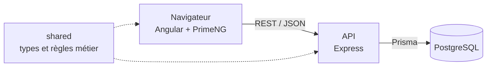

# Architecture — ForgeRoster

ForgeRoster est une application web en trois parties : une interface Angular, une API REST Express et une base PostgreSQL. L'objectif de cette organisation est simple : rester lisible pour un projet de cette taille, et garantir que les règles du jeu sont appliquées au même endroit, côté interface comme côté serveur.

## Vue d'ensemble



## Organisation du dépôt

Le dépôt réunit les trois parties du code, gérées avec les workspaces npm.

```
frontend/   Application Angular
backend/    API Express
shared/     Types et règles métier communes
docs/       Documentation du projet
```

**Pourquoi un dossier `shared`.** Le calcul de probabilités doit s'exécuter dans le navigateur pour répondre en moins de 200 ms, et les règles d'un warband doivent être vérifiées à l'écran comme sur l'API. Sans code commun, ces règles seraient écrites deux fois, avec le risque qu'elles divergent.

## Architecture frontend

Le code est rangé par fonctionnalité plutôt que par type de fichier. Tout ce qui concerne le partage se trouve au même endroit, ce qui correspond au découpage en epics du backlog.

```
frontend/src/app/
  core/                 Services uniques : authentification, intercepteur HTTP, gardes de route
  shared/               Composants réutilisables, sans logique métier
  features/
    auth/               Inscription, connexion
    warband-builder/    Construction du warband, équipement, règles spéciales
    calculator/         Panneau de probabilités
    my-warbands/        Liste, recherche, duplication
    share/              Génération du lien, vue adversaire
    export/             Fenêtre d'export PDF
    admin/              Gestion du catalogue
```

Chaque fonctionnalité suit la même répartition :

- **Page** : une route. Elle charge les données et coordonne l'écran.
- **Composant** : une partie de l'écran. Il reçoit des données et émet des événements.
- **Service** : les appels à l'API, avec `HttpClient`.
- **Store** : l'état de la fonctionnalité, en Signals. Le solde en Ducats et les probabilités sont des `computed()` : ils se recalculent seuls quand le warband change.

Les fonctionnalités sont chargées à la demande par le routeur, ce qui réduit le poids de la page d'accueil.

## Architecture backend

L'API est découpée en modules, un par domaine. Chaque module suit trois couches.

```
backend/src/
  modules/
    auth/
    catalog/
    warbands/
    share-links/
    export/
  middlewares/          Authentification, contrôle du rôle, validation, gestion des erreurs
  app.ts                Configuration d'Express
  server.ts             Démarrage
```

| Couche | Fichier | Rôle |
|---|---|---|
| Route | `warbands.routes.ts` | Associe une URL à son contrôleur et à ses middlewares |
| Contrôleur | `warbands.controller.ts` | Lit la requête, appelle le service, renvoie la réponse. Aucune règle métier. |
| Service | `warbands.service.ts` | Applique les règles métier et accède aux données avec Prisma |

Les schémas Zod de chaque module (`warbands.schemas.ts`) valident les entrées avant le contrôleur. Une donnée invalide n'atteint donc jamais le service.

## Séparation des responsabilités

| Élément | Responsable de | N'est pas responsable de |
|---|---|---|
| Composant Angular | Afficher, recueillir les actions de l'utilisateur | Appeler l'API, décider d'une règle |
| Service Angular | Échanger avec l'API | Afficher |
| `shared` | Calculer et vérifier, avec des fonctions pures | Accéder au réseau ou à la base |
| Contrôleur | Traduire HTTP vers le service | Connaître les règles du jeu |
| Service backend | Faire respecter les règles et les droits | Connaître HTTP |
| PostgreSQL | Garantir l'intégrité des données | Connaître les règles du jeu |

## Circulation des données

**Ajouter un combattant au warband**

1. Le joueur choisit un combattant dans la fenêtre d'ajout.
2. Le store vérifie les règles avec `shared` et affiche tout de suite le nouveau solde ou un message de blocage.
3. Le service Angular envoie la requête à l'API, avec le jeton de connexion.
4. Les middlewares contrôlent le jeton et valident les données.
5. Le service backend vérifie que le warband appartient au joueur, puis relance les règles de `shared` sur les données de la base.
6. Prisma enregistre la recrue, et l'API renvoie le warband à jour.

**Calculer une probabilité**

1. Le joueur choisit un combattant, une arme et une cible.
2. Le store réunit le profil, l'équipement, les règles spéciales et l'armure de la cible.
3. Le moteur de `shared` calcule les résultats dans le navigateur, sans appel au serveur.
4. Le panneau affiche les probabilités et les modificateurs actifs.

**Ouvrir un lien de partage**

1. L'adversaire ouvre le lien, sans compte.
2. L'API retrouve le partage par son jeton et vérifie qu'il est actif et non expiré.
3. Elle renvoie le warband en lecture seule, sans donnée personnelle.

## Emplacement de la logique métier

| Règle | Emplacement | Raison |
|---|---|---|
| Calcul des jets de réussite et de blessure | `shared`, exécuté dans le navigateur | Réponse immédiate, sans appel au serveur |
| Budget, disponibilités, limite d'Élites, faction, équipement autorisé | `shared`, exécuté dans le navigateur et sur l'API | L'interface prévient, l'API décide |
| Propriétaire d'un warband, rôle administrateur, validité d'un lien | Service backend uniquement | Un contrôle côté navigateur peut être contourné |
| Unicité, clés étrangères, valeurs autorisées | PostgreSQL | Dernière protection, quel que soit le code |

L'API ne fait jamais confiance aux données reçues du navigateur : tout contrôle fait dans l'interface est refait côté serveur.

## Choix écartés

- **NestJS** : son cadre apporte peu sur une API de cette taille, et Express suffit à appliquer ces couches.
- **Microservices** : l'application a un seul domaine et un seul développeur. Plusieurs services ajouteraient du déploiement sans bénéfice.
- **Architecture hexagonale et couche Repository** : Prisma isole déjà l'accès aux données. Une abstraction de plus n'aurait qu'une seule implémentation.
- **NgRx** : les Signals suffisent à l'état d'un warband en cours d'édition.

## Versions

Versions vérifiées le 2 novembre 2026.

| Élément | Version | Remarque |
|---|---|---|
| Node.js | 24 LTS | Maintenu jusqu'en avril 2028 |
| Angular | 22 | Maintenu jusqu'en juin 2028 |
| PrimeNG | 22 | Licence Community gratuite pour un particulier, avec une clé |
| TypeScript | 6.0 | Imposé par Angular 22, qui n'accepte pas encore TypeScript 7 |
| Express | 5 | |
| Prisma | 7.10 | La version 8 est encore une version candidate |
| PostgreSQL | 18 | Maintenu jusqu'en novembre 2030 |
| Zod | 4 | |
| Vitest | 5 | Outil de test pris en charge par Angular, utilisé aussi pour l'API |

La gestion du jeton de connexion côté navigateur sera décidée avec la partie sécurité.
