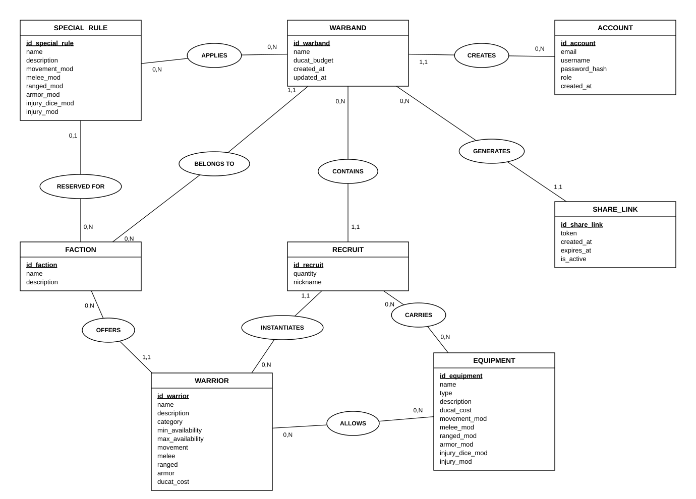

# MCD — Modèle Conceptuel de Données

Première étape de la méthode Merise. Le MCD décrit les entités du domaine, leurs attributs et leurs associations, sans détail technique : pas de clé étrangère, pas de type de colonne, pas de table de jointure. Ces éléments apparaîtront au MLD puis au MPD. Les noms d'entités, d'attributs et d'associations sont en anglais, comme le code.

## Entités et attributs

L'identifiant de chaque entité est en gras.

| Entité | Attributs | Rôle |
|---|---|---|
| ACCOUNT | **id_account**, email, username, password_hash, role, created_at | Compte d'un joueur ou d'un administrateur |
| FACTION | **id_faction**, name, description | Faction du jeu |
| WARRIOR | **id_warrior**, name, description, category, min_availability, max_availability, movement, melee, ranged, armor, ducat_cost | Combattant de référence du catalogue |
| EQUIPMENT | **id_equipment**, name, type, description, ducat_cost, movement_mod, melee_mod, ranged_mod, armor_mod, injury_dice_mod, injury_mod | Arme, protection ou accessoire |
| SPECIAL_RULE | **id_special_rule**, name, description, movement_mod, melee_mod, ranged_mod, armor_mod, injury_dice_mod, injury_mod | Bonus ou malus applicable à un warband, réservé ou non à une faction |
| WARBAND | **id_warband**, name, ducat_budget, created_at, updated_at | Bande de guerre d'un joueur |
| RECRUIT | **id_recruit**, quantity, nickname | Combattant du catalogue placé dans un warband |
| SHARE_LINK | **id_share_link**, token, created_at, expires_at, is_active | Lien de partage d'un warband |

## Associations et cardinalités

Une cardinalité se lit depuis l'entité : « un ACCOUNT crée entre 0 et N WARBAND ».

| Association | Entité A | Cardinalité A | Entité B | Cardinalité B | Lecture |
|---|---|---|---|---|---|
| CREATES | ACCOUNT | 0,N | WARBAND | 1,1 | Un utilisateur crée zéro ou plusieurs warbands ; un warband a un seul créateur |
| BELONGS TO | WARBAND | 1,1 | FACTION | 0,N | Un warband relève d'une seule faction |
| OFFERS | FACTION | 0,N | WARRIOR | 1,1 | Une faction propose plusieurs combattants ; un combattant appartient à une seule faction |
| CONTAINS | WARBAND | 0,N | RECRUIT | 1,1 | Un warband regroupe plusieurs recrues ; une recrue est dans un seul warband |
| INSTANTIATES | WARRIOR | 0,N | RECRUIT | 1,1 | Une recrue correspond à un seul combattant du catalogue |
| ALLOWS | WARRIOR | 0,N | EQUIPMENT | 0,N | Un combattant a accès à plusieurs équipements, et inversement |
| CARRIES | RECRUIT | 0,N | EQUIPMENT | 0,N | Une recrue porte plusieurs équipements, et inversement |
| APPLIES | WARBAND | 0,N | SPECIAL_RULE | 0,N | Un warband applique plusieurs règles, et inversement |
| GENERATES | WARBAND | 0,N | SHARE_LINK | 1,1 | Un warband génère plusieurs liens ; un lien concerne un seul warband |
| RESERVED FOR | SPECIAL_RULE | 0,1 | FACTION | 0,N | Une règle est réservée à une faction au plus ; sans lien, elle vaut pour toutes |

## Schéma

## Choix de modélisation

**WARRIOR et RECRUIT sont deux entités distinctes.** Le combattant est la fiche de référence du catalogue, identique pour tous les joueurs. La recrue est son exemplaire dans un warband précis, avec sa quantité, son surnom et son propre équipement. Deux joueurs peuvent recruter le même combattant et l'équiper différemment.

**Deux associations relient l'équipement.** ALLOWS dit ce qu'un combattant a le droit de porter, c'est une règle du jeu. CARRIES dit ce qu'une recrue porte réellement, c'est un choix du joueur. La première sert à contrôler la seconde.

**Les Ducats dépensés ne sont pas un attribut du warband.** Ils se calculent à partir des recrues et de leur équipement. Les stocker créerait un risque d'incohérence entre la valeur enregistrée et le contenu réel.

**SPECIAL_RULE est une entité autonome.** Elle n'est pas rattachée directement au warband mais reliée par l'association APPLIES. Si des règles propres à une recrue sont ajoutées plus tard, il suffira d'une nouvelle association entre RECRUIT et SPECIAL_RULE, sans modifier l'existant.

**Le profil reprend celui du jeu.** `melee` et `ranged` sont des bonus en dés (+2D), `armor` un modificateur négatif (-2), `movement` une distance en pouces. Ces valeurs ont été vérifiées sur des profils réels.

**Les effets sont portés par six attributs.** Ils suivent les modificateurs du jeu : `melee_mod` et `ranged_mod` en dés sur le jet de réussite, `injury_dice_mod` en dés sur le jet de blessure, `injury_mod` sur son résultat, `armor_mod` sur le jet de blessure subi, `movement_mod` en pouces. Une entité EFFET serait plus souple, mais ces attributs suffisent au calculateur et restent simples à expliquer. Les bonus d'une arme ne comptent que pour l'attaque faite avec elle.

**La catégorie et la disponibilité portent la structure du warband.** `category` vaut LEADER, ELITE ou INFANTRY : un warband compte 6 LEADER et ELITE au plus. `min_availability` et `max_availability` donnent le nombre minimum et maximum d'un même combattant. Un Lieutenant vaut 1 et 1, ce qui rend le chef obligatoire. Un Yeoman vaut 0 et vide : il est facultatif et illimité.

**RESERVED FOR est facultative.** Certaines règles appartiennent à une faction, d'autres valent pour toutes. Une règle réservée n'est proposée qu'aux warbands de sa faction.

**Une recrue groupée porte le même équipement.** Une recrue de quantité 3 désigne trois combattants identiques. Pour les équiper différemment, le joueur crée plusieurs recrues.

**Le rôle est un attribut de l'utilisateur.** Il distingue le joueur de l'administrateur. Deux valeurs suffisent, une entité ROLE séparée serait disproportionnée.

**L'adversaire n'apparaît pas.** Il n'a pas de compte et n'enregistre rien : il accède à un warband par le jeton d'un SHARE_LINK.

**Le journal de calcul est retiré.** Aucune fonctionnalité du cahier des charges ne l'utilise.

## Hors MVP

Glory Points, mercenaires, variantes de warband et mots-clés ne sont pas modélisés. Un warband de départ peut s'en passer. Les mercenaires sont les seuls combattants partagés entre factions : les écarter permet de garder un combattant dans une seule faction.
