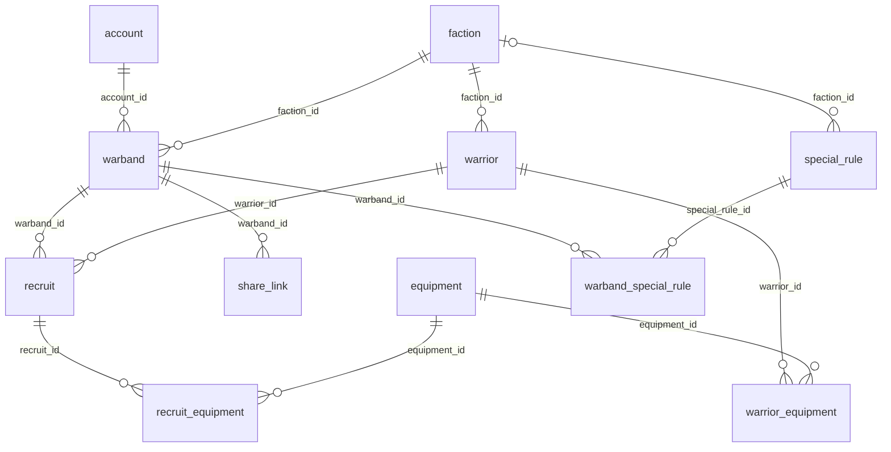

# MLD — Modèle Logique de Données

Deuxième étape de la méthode Merise. Le MLD transforme le [MCD](mcd.md) en tables relationnelles : les entités deviennent des tables, les identifiants deviennent des clés primaires, et les associations deviennent des clés étrangères ou des tables de jointure.

## Règles de passage appliquées

1. **Une entité devient une table.** Son identifiant devient la clé primaire.
2. **Une association 1,1 — 0,N devient une clé étrangère**, placée dans la table du côté 1,1. Exemple : un warband a un seul créateur, donc `warband` reçoit `account_id`.
3. **Une association 0,1 — 0,N devient une clé étrangère facultative**, placée du côté 0,1. Exemple : une règle spéciale peut être réservée à une faction, donc `special_rule` reçoit `faction_id`, qui peut rester vide.
4. **Une association 0,N — 0,N devient une table de jointure.** Sa clé primaire est composée des deux clés étrangères. Exemple : CARRIES devient `recruit_equipment`.

| Association du MCD | Cardinalités | Traduction |
|---|---|---|
| CREATES | 0,N — 1,1 | Clé étrangère `account_id` dans `warband` |
| BELONGS TO | 1,1 — 0,N | Clé étrangère `faction_id` dans `warband` |
| OFFERS | 0,N — 1,1 | Clé étrangère `faction_id` dans `warrior` |
| CONTAINS | 0,N — 1,1 | Clé étrangère `warband_id` dans `recruit` |
| INSTANTIATES | 0,N — 1,1 | Clé étrangère `warrior_id` dans `recruit` |
| GENERATES | 0,N — 1,1 | Clé étrangère `warband_id` dans `share_link` |
| RESERVED FOR | 0,1 — 0,N | Clé étrangère facultative `faction_id` dans `special_rule` |
| ALLOWS | 0,N — 0,N | Table de jointure `warrior_equipment` |
| CARRIES | 0,N — 0,N | Table de jointure `recruit_equipment` |
| APPLIES | 0,N — 0,N | Table de jointure `warband_special_rule` |

## Schéma relationnel

Clé primaire en **gras**, clé étrangère précédée de `#`.

- **account** (**id**, email, username, password_hash, role, created_at)
- **faction** (**id**, name, description)
- **warrior** (**id**, name, description, category, min_availability, max_availability, movement, melee, ranged, armor, ducat_cost, #faction_id)
- **equipment** (**id**, name, type, description, ducat_cost, movement_mod, melee_mod, ranged_mod, armor_mod, injury_dice_mod, injury_mod)
- **special_rule** (**id**, name, description, movement_mod, melee_mod, ranged_mod, armor_mod, injury_dice_mod, injury_mod, #faction_id)
- **warband** (**id**, name, ducat_budget, created_at, updated_at, #account_id, #faction_id)
- **recruit** (**id**, quantity, nickname, #warband_id, #warrior_id)
- **share_link** (**id**, token, created_at, expires_at, is_active, #warband_id)
- **warrior_equipment** (**#warrior_id**, **#equipment_id**)
- **recruit_equipment** (**#recruit_id**, **#equipment_id**)
- **warband_special_rule** (**#warband_id**, **#special_rule_id**)

Le modèle passe de 8 entités à 11 tables : les 8 entités, plus une table de jointure pour chacune des 3 associations de plusieurs à plusieurs.

## Diagramme

Les liens portent le nom de la clé étrangère. Le détail des colonnes et de leurs types figure dans le [MPD](mpd.md).

## Règles de nommage

- Noms de tables et de colonnes en anglais, en minuscules, mots séparés par un tiret bas.
- La table des comptes s'appelle `account`, car `user` est un mot réservé en PostgreSQL.
- Nom de table au singulier.
- Clé primaire nommée `id`.
- Clé étrangère nommée `<table référencée>_id`.
- Table de jointure nommée d'après les deux tables qu'elle relie.

## Normalisation

Le schéma respecte les trois premières formes normales.

- **1FN** : chaque colonne contient une seule valeur. L'équipement d'une recrue n'est pas une liste dans une colonne, mais des lignes dans `recruit_equipment`.
- **2FN** : dans les tables de jointure, aucune colonne ne dépend d'une partie seulement de la clé. Elles ne contiennent que leur clé.
- **3FN** : aucune colonne ne dépend d'une autre colonne non clé. Le total de Ducats dépensés n'est pas stocké dans `warband`, puisqu'il se déduit des recrues et de leur équipement.

## Hypothèse

Un combattant appartient à une seule faction. Les mercenaires, partagés entre factions, sont hors du MVP. Pour les ajouter, `faction_id` dans `warrior` deviendrait une table de jointure.
