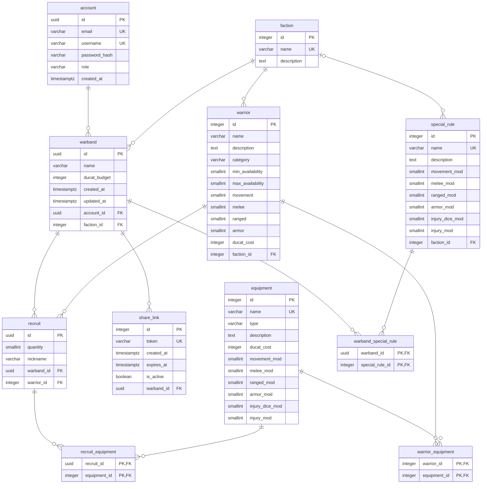

# MPD — Modèle Physique de Données

Dernière étape de la méthode Merise. Le MPD traduit le [MLD](mld.md) pour un système de gestion de base de données précis, ici PostgreSQL : chaque colonne reçoit un type, et les règles du domaine deviennent des contraintes.

Le script de création est dans [mpd.sql](mpd.sql).

## Diagramme

## Choix de types

| Donnée | Type | Raison |
|---|---|---|
| Identifiant d'un utilisateur, d'un warband, d'une recrue | `UUID` | Ces identifiants circulent dans les adresses et les requêtes. Un entier qui s'incrémente se devine : il suffirait de changer un chiffre pour viser le warband d'un autre joueur. Un UUID est imprévisible. |
| Identifiant du catalogue et d'un partage | `INTEGER` auto-généré | Données publiques ou jamais exposées. Le partage est désigné par son jeton, pas par son identifiant. |
| Dates | `TIMESTAMPTZ` | Conserve le fuseau horaire, nécessaire pour comparer une date d'expiration à l'heure courante. |
| Caractéristiques, modificateurs, disponibilité | `SMALLINT` | Petites valeurs entières. Un modificateur peut être négatif. Une disponibilité vide signifie illimitée. |
| Coûts et budget | `INTEGER` | Les Ducats sont des nombres entiers. |
| Rôle, type d'équipement, catégorie | `VARCHAR` avec contrainte `CHECK` | Liste fermée de valeurs. Plus simple à faire évoluer qu'un type `ENUM`, qui demande une modification de structure pour ajouter une valeur. |
| Description | `TEXT` | Longueur libre. |

## Contraintes

| Règle du domaine | Contrainte |
|---|---|
| Deux comptes ne partagent ni e-mail ni pseudo | `UNIQUE` sur `email` et sur `username` |
| Un rôle vaut PLAYER ou ADMIN | `CHECK` sur `role` |
| Une catégorie vaut LEADER, ELITE ou INFANTRY | `CHECK` sur `category` |
| Une disponibilité minimale n'est jamais négative | `CHECK (min_availability >= 0)` |
| Une disponibilité maximale vaut au moins 1 et au moins le minimum | `CHECK (max_availability >= 1)` et `CHECK (max_availability >= min_availability)` |
| Un coût n'est jamais négatif | `CHECK (ducat_cost >= 0)` |
| Un budget est strictement positif | `CHECK (ducat_budget > 0)` |
| Une recrue représente au moins un combattant | `CHECK (quantity >= 1)` |
| Un lien expire après sa création | `CHECK (expires_at > created_at)` |
| Un jeton de partage est unique | `UNIQUE` sur `token` |
| Deux combattants d'une même faction n'ont pas le même nom | `UNIQUE (faction_id, name)` |
| Une recrue ne porte pas deux fois le même équipement | Clé primaire composée de `recruit_equipment` |

## Comportement à la suppression

| Suppression de | Effet | Raison |
|---|---|---|
| Un utilisateur | Ses warbands, recrues, équipements portés, règles appliquées et partages sont supprimés (`CASCADE`) | Droit à l'effacement prévu par le RGPD : aucune donnée du joueur ne subsiste |
| Un warband | Ses recrues, règles appliquées et partages sont supprimés (`CASCADE`) | Ces données n'ont pas de sens sans le warband |
| Un combattant, un équipement, une règle ou une faction encore utilisés | Refusée (`RESTRICT`) | Un administrateur ne peut pas casser les warbands des joueurs en retirant une donnée de référence |

## Index

PostgreSQL crée un index pour chaque clé primaire et chaque contrainte `UNIQUE`, mais pas pour les clés étrangères. Sept index sont ajoutés sur les colonnes servant de filtre aux requêtes courantes.

| Index | Requête servie |
|---|---|
| `warband (account_id)` | Lister les warbands d'un joueur |
| `recruit (warband_id)` | Charger les recrues d'un warband |
| `warrior (faction_id)` | Afficher le catalogue d'une faction |
| `share_link (warband_id)` | Lister les liens d'un warband |
| `recruit_equipment (equipment_id)` | Vérifier qu'un équipement est encore porté avant de le supprimer |
| `warrior_equipment (equipment_id)` | Retrouver les combattants autorisés à porter un équipement |
| `special_rule (faction_id)` | Lister les règles proposées à une faction |

## Règles vérifiées par l'application

Huit règles ne sont pas garanties par la base et devront être contrôlées dans la couche métier, côté API.

1. Une recrue ne porte que des équipements autorisés pour son combattant.
2. Le combattant d'une recrue appartient à la faction du warband.
3. Le total des Ducats dépensés ne dépasse pas le budget du warband.
4. Un warband n'a qu'un seul lien de partage actif : un nouveau lien désactive le précédent.
5. Un warband ne dépasse pas la disponibilité maximale d'un combattant.
6. Un warband compte 6 combattants de catégorie Chef ou Élite au plus.
7. Une règle réservée à une faction ne s'applique qu'à un warband de cette faction.
8. Un warband atteint la disponibilité minimale de chaque combattant, dont son chef, avant d'être partagé ou exporté. Il peut être sauvegardé incomplet.

Le total dépensé n'est pas stocké. Il se calcule par une requête sur les recrues et leur équipement.

## Vérification

Le script a été exécuté sur PGlite 0.3.15, qui embarque PostgreSQL 17.5. La cible du projet est PostgreSQL 16 : le script n'utilise aucune fonctionnalité postérieure, mais il reste à rejouer sur la version cible une fois l'environnement Docker en place.

| Vérification | Résultat |
|---|---|
| Exécution du script, deux fois de suite | 11 tables créées, script rejouable |
| Identifiant UUID généré automatiquement | Conforme |
| Rôle par défaut | PLAYER |
| Calcul des Ducats dépensés (2 recrues à 45, équipées à 15) | 120, conforme |
| E-mail en double | Refusé |
| Rôle inconnu | Refusé |
| Quantité à zéro | Refusée |
| Type d'équipement inconnu | Refusé |
| Coût négatif | Refusé |
| Expiration antérieure à la création | Refusée |
| Jeton en double | Refusé |
| Suppression d'un combattant recruté | Refusée |
| Suppression d'une faction utilisée | Refusée |
| Combattant rattaché à une faction inexistante | Refusé |
| Catégorie inconnue | Refusée |
| Disponibilité maximale à zéro | Refusée |
| Disponibilité minimale négative | Refusée |
| Disponibilité maximale inférieure au minimum | Refusée |
| Règle rattachée à une faction inexistante | Refusée |
| Suppression d'une règle appliquée à un warband | Refusée |
| Suppression d'une faction qui porte une règle réservée | Refusée |
| Suppression d'un compte | Warbands, recrues, équipements portés, règles et partages supprimés ; catalogue intact |

## Reste à faire

- **Droits d'accès à la base.** Le référentiel demande de définir les utilisateurs de la base et leurs droits. À prévoir avec l'environnement Docker : un compte applicatif limité à la lecture et à l'écriture des données, sans droit de modifier la structure.
- **Jeu de données de test** et sa sauvegarde, pour pouvoir restaurer la base.
- **Choix de l'outil de migration.** Le cahier des charges prévoit Prisma, qui génère la structure à partir de son propre schéma. Il faudra décider lequel des deux, ce script ou le schéma Prisma, fait référence.
- **Mise à jour de `updated_at`**, par l'application ou par un déclencheur.

## Hypothèse

Un combattant appartient à une seule faction. Les mercenaires, partagés entre factions, sont hors du MVP.
