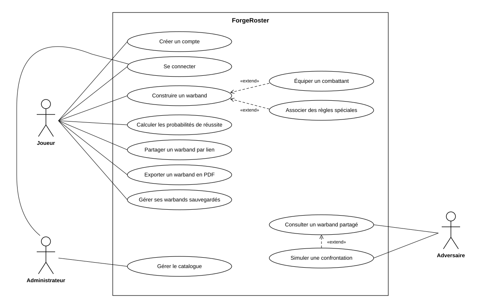

# Diagramme de cas d'utilisation — ForgeRoster

Le diagramme répond à une question : qui peut faire quoi dans l'application. Il reste au niveau des fonctionnalités métier et ne décrit ni les écrans ni les boutons.

## Acteurs

| Acteur | Rôle | Compte requis |
|---|---|---|
| Joueur | Construit, équipe, sauvegarde et partage ses warbands. Acteur principal. | Oui |
| Adversaire | Consulte un warband reçu par lien et simule une confrontation. | Non |
| Administrateur | Gère le catalogue : factions, combattants, équipements, règles spéciales. | Oui |

## Cas d'utilisation

| Cas d'utilisation | Acteur | Précision |
|---|---|---|
| Créer un compte | Joueur | |
| Se connecter | Joueur, Administrateur | Préalable à tous les autres cas de ces deux acteurs |
| Construire un warband | Joueur | Choisir une faction, ajouter et retirer des combattants, suivre le budget en Ducats |
| Équiper un combattant | Joueur | Étend « Construire un warband » |
| Associer des règles spéciales | Joueur | Étend « Construire un warband » |
| Calculer les probabilités de réussite | Joueur | Jet de réussite, puis jet de blessure contre une cible. Tient compte de l'équipement et des règles spéciales |
| Partager un warband par lien | Joueur | Lien unique, QR code, durée de validité |
| Exporter un warband en PDF | Joueur | |
| Gérer ses warbands sauvegardés | Joueur | Rouvrir, dupliquer, supprimer |
| Consulter un warband partagé | Adversaire | Lecture seule, depuis le lien reçu |
| Simuler une confrontation | Adversaire | Étend « Consulter un warband partagé » |
| Gérer le catalogue | Administrateur | Créer, modifier, supprimer les données de référence |

## Choix de modélisation

- **Les relations « extend »** marquent un comportement optionnel. Un joueur peut construire un warband sans équiper ses combattants ni ajouter de règle spéciale. De même, l'adversaire peut consulter un warband sans lancer de simulation.
- **L'authentification n'est pas reliée par des « include »** à chaque cas, pour garder le diagramme lisible. Elle est indiquée comme préalable dans le tableau.
- **L'adversaire n'a pas de compte.** Le lien de partage suffit à lui donner un accès en lecture seule. Pour simuler une attaque, il saisit l'armure de sa cible.
- **Un compte a un seul rôle.** L'administrateur ne construit pas de warband : il agit uniquement sur les données de référence. Pour jouer, il crée un second compte.
